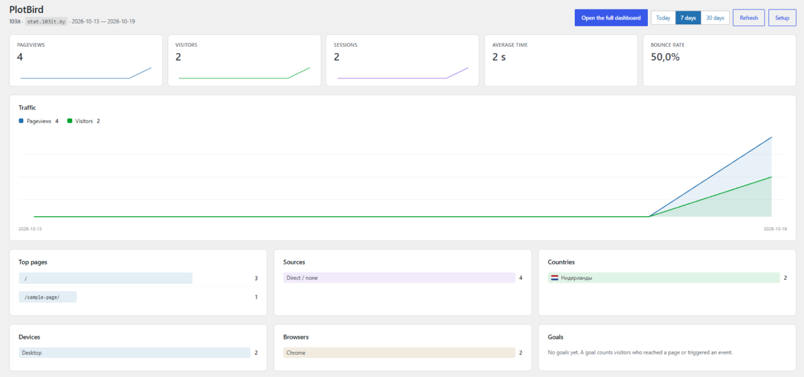

# PlotBird Analytics for WordPress

Adds the [PlotBird](https://github.com/plotbird/analytics) tracking code to a
WordPress site, and shows the statistics inside the WordPress admin — no iframe,
no third-party service, no cookies.



PlotBird itself is self-hosted, cookie-free web analytics in plain PHP and MySQL.
This plugin is only the client: it sends pageviews to the installation you
control and reads the numbers back through a read-only share link. That
installation is the address you enter on the setup screen, so the plugin loads
no code from a server of ours, and sends nothing anywhere else.

- **Requires:** WordPress 6.0+, PHP 7.4+
- **Licence:** GPL-2.0-or-later
- **Languages:** English, Русский (follows the site language, can be overridden)

## What it does

- Injects the tracker on every public page — never in the admin, feeds, or
  previews, and never for logged-in administrators if you leave that option on.
- **Setup wizard** in four steps, with checks that actually test the connection
  rather than trusting the fields: it fetches `tracker.js` from your installation
  and looks for the tag on your front page.
- **Statistics screen** in the admin: pageviews, visitors, sessions, average
  time, bounce rate, a traffic chart, top pages, sources, countries, devices,
  browsers and goals.
- Works with a PlotBird installation in a sub-directory (`/plotbird/`) or on
  another domain.

## Install

1. Copy this folder to `wp-content/plugins/plotbird-analytics`, or upload the
   release ZIP under **Plugins → Add New → Upload Plugin**.
2. Activate it.
3. Open **Settings → PlotBird** and follow the four steps.

You need a running PlotBird installation. It is a folder of PHP files you upload
to your hosting and open in a browser — see the
[installation guide](https://github.com/plotbird/analytics#quick-start).

## The four steps

1. **Where PlotBird lives** — paste the address, e.g.
   `https://example.com/plotbird`. The button checks that `tracker.js` answers
   there and that it is really PlotBird.
2. **Website id** — the UUID from the site's code panel in PlotBird. Wrong ids
   are rejected before they can produce silent zeroes.
3. **Statistics inside WordPress** — a share link from PlotBird
   (**Websites → Links and goals**). It is read-only and can be revoked at any
   time; the plugin never stores a password.
4. **Check it works** — the plugin loads your front page and looks for the
   tracking tag in the HTML, which catches caching plugins.

## Why statistics need a share link

Reading numbers requires a credential. Storing an administrator password in
WordPress would be wrong, and a PlotBird session lives only in your browser. A
share link is the narrowest thing that works: read-only, revocable, optionally
expiring. The plugin shows a clear message if the link is revoked or belongs to
another website.

## "I see no statistics"

The most common reason: **you are looking at your own site while logged in.**
With *Do not track logged-in administrators* enabled (the default), the plugin
does not print the tag for you at all. Check in a private window, or untick the
option.

Other things worth checking:

- A caching plugin may serve a page rendered before the tag was added — clear
  its cache and use the check in step 4.
- A hit appears in the dashboard within a minute; the plugin caches its own
  response for 60 seconds, and *Refresh* clears that.
- If your site answers on both `example.com` and `www.example.com`, make sure the
  website in PlotBird accepts the host you actually browse.

## Privacy

No cookies are set and no personal data is stored. PlotBird derives a daily
visitor id from a salted hash of the anonymised IP address and the user agent,
then discards the raw values unless you explicitly enable storing IP addresses.
The plugin itself sends nothing anywhere except your own PlotBird installation.

## Development

```
php -l plotbird-analytics.php     # syntax check
```

Translation files live in `languages/`. The source strings are English; the
Russian catalogue is `plotbird-analytics-ru_RU.po` with the compiled `.mo`.

## Licence

GPL-2.0-or-later. PlotBird Analytics (the server) is AGPL-3.0-or-later; this
plugin contains no code from it.
